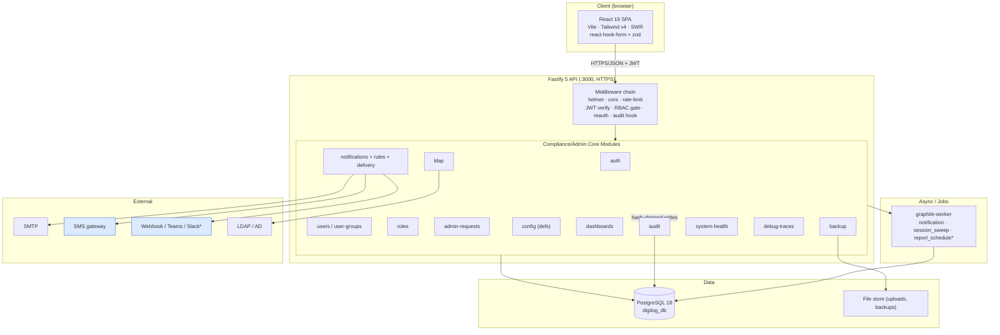
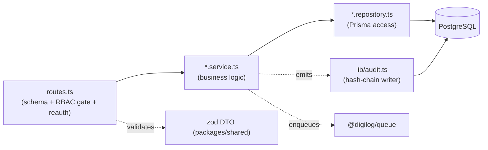
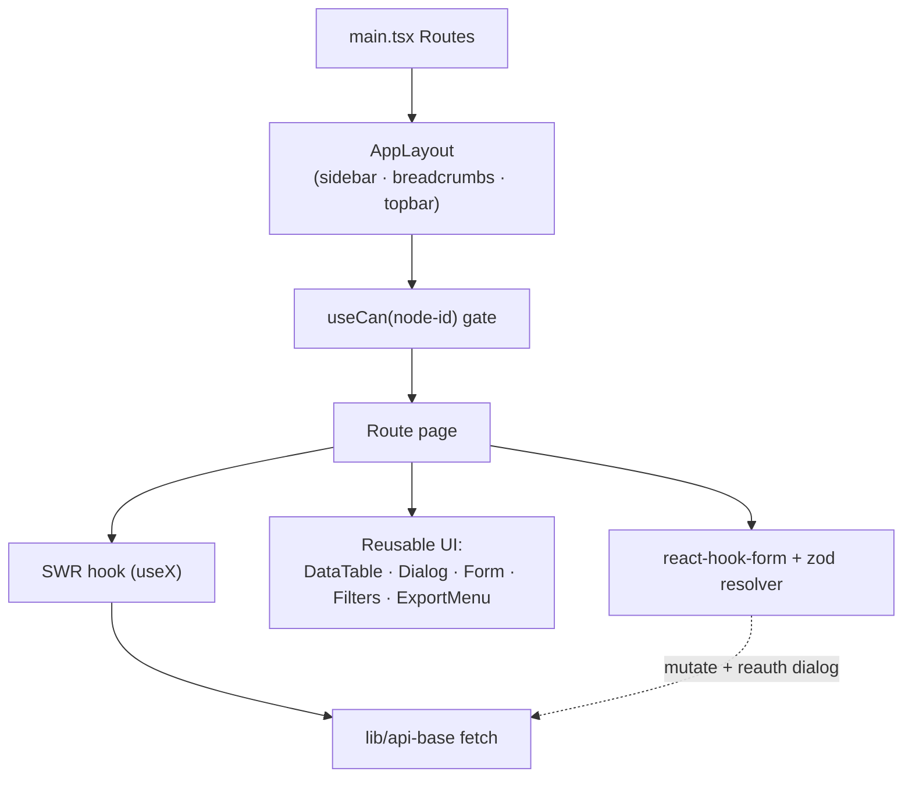
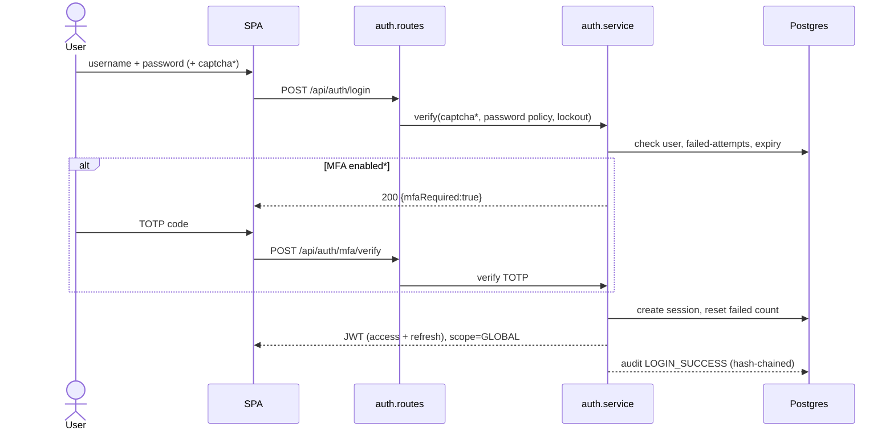
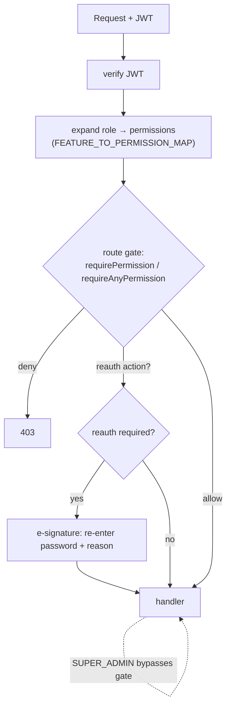
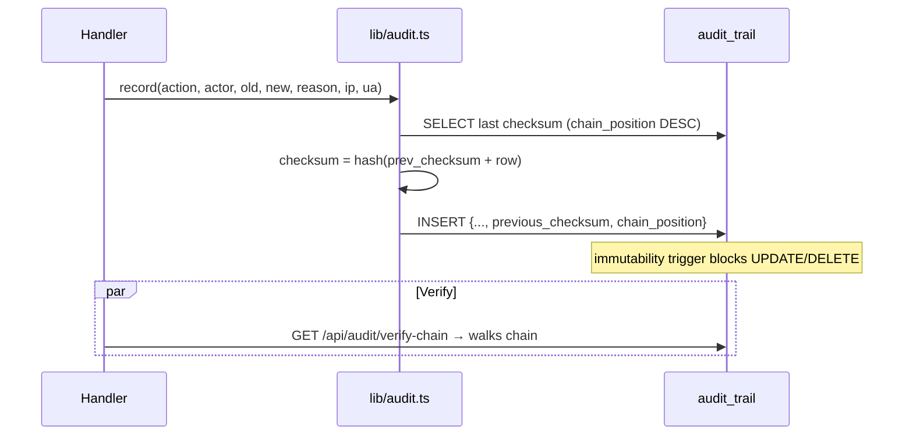
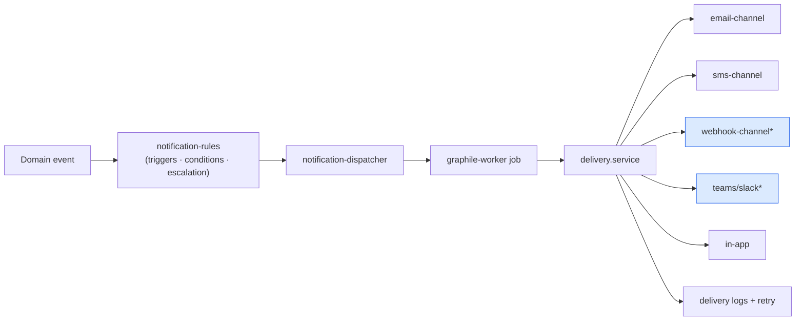
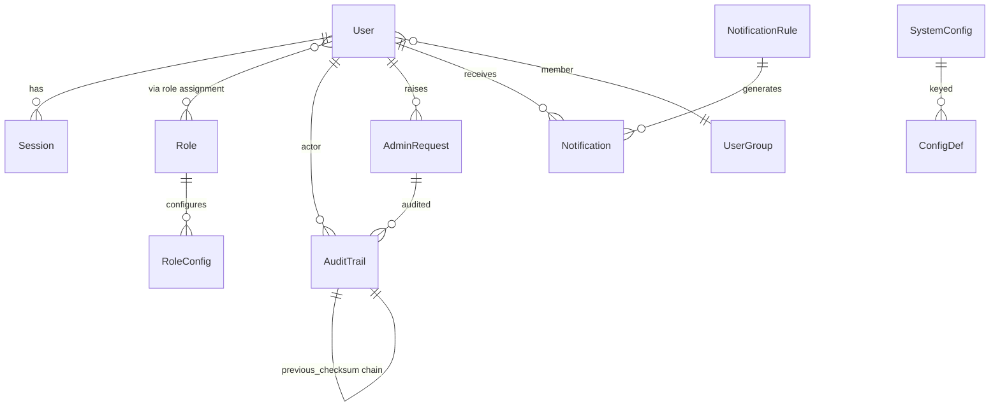
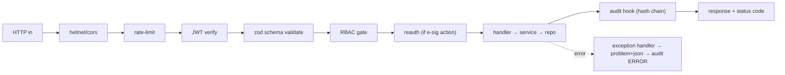
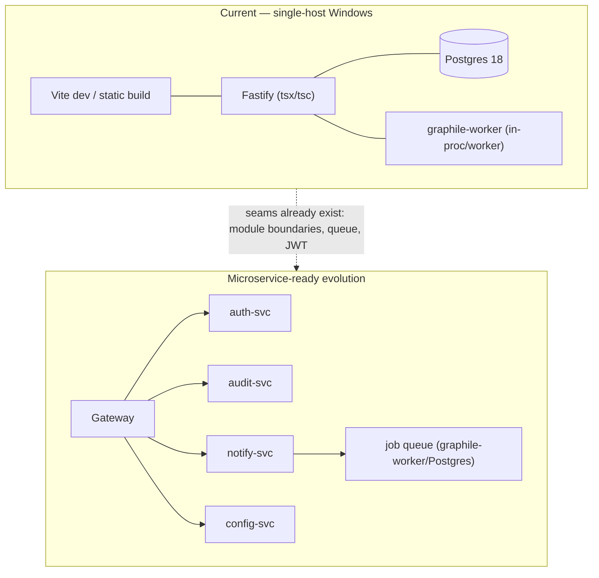

# compliance-core — Target Architecture & Roadmap

_Post-decision (2026-07-18): **strip cleanroom domain**, **keep React 19 + Tailwind + SWR / Fastify + Prisma stack**, build **all four gap areas**._

This document holds the target-state diagrams and the phased plan. Current-state analysis + gap matrix live in [`COMPLIANCE-CORE-ANALYSIS.md`](./COMPLIANCE-CORE-ANALYSIS.md). The precise delete manifest lives in [`STRIP-MANIFEST.md`](./STRIP-MANIFEST.md) (generated from dependency discovery).

---

## 1. Target System Architecture

_`*` = new/gap work (Phase 2–3)._

## 2. Backend Architecture (clean-architecture layering per module)

## 3. Frontend Component Flow

## 4. Authentication Flow (with target MFA)

_`*` captcha + MFA = Phase 1._

## 5. Authorization / RBAC Flow

## 6. Audit Trail Flow (tamper-evident hash chain)

## 7. Notification Flow (with target channels)

## 8. Target Core ER (high level)

_(Domain models removed; core keeps User, Role, Session, AuditTrail, AdminRequest, Notification*, SystemConfig, UserGroup, Backup, help, etc. Final list confirmed post-strip.)_

## 9. Request Lifecycle

## 10. Deployment (current: local Windows; microservice-ready)

---

## 11. Roadmap

### Phase 0 — Domain strip (foundation) ✅ DONE (2026-07-18)
Executed and verified: models 61→23, enums 23→6, perms 102→31, reauth 92→39, sidebar 27→10, config defs 36→21, api modules 33→18. All compile gates + runtime gate (boot/login/audit verify-chain/web build) green. DB re-baselined fresh; audit hash chain `intact:true`. Restored generic `report-page-titles` config. Remaining: vitest runtime test rework; DigiLog-era doc rewrite.

Execute per `STRIP-MANIFEST.md`. Order: cut core→domain couplings → remove domain routes from `app.ts` → delete domain modules/models/config-defs/frontend routes → drop domain perms/reauth/sidebar/schema nodes → prune seed → `prisma migrate` → build + test green. Git tag `pre-domain-strip` before starting. **Verify:** API boots, `/api/health` 200, login works, audit chain verifies, no dangling imports (`tsc` clean), web builds.

### Phase 1 — Auth hardening
- **MFA/TOTP**: `otplib`-style secret + QR enrollment, `POST /api/auth/mfa/{enroll,verify,disable}`, per-user `mfaEnabled`/`mfaSecret`, config toggle, reauth-gated disable, audit events. UI: enroll dialog, login MFA step.
- **CAPTCHA**: configurable provider (turnstile/hcaptcha/off) wired into existing `login-security.def.ts`; backend verify before password check.
- **Concurrent-login control**: max-sessions config, evict-oldest or block, session list UI.

### Phase 2 — Notification channels
Extend `notification-delivery/channels/` (email, sms → **webhook, teams, slack, push**). New channel classes implementing the existing channel interface; config defs for endpoints/tokens; per-rule channel selection; delivery logs + retry reuse. UI: channel config pages.

### Phase 3 — Audit reporting
Scheduled canned Daily/Monthly/Yearly + user/module-wise audit reports. New graphile-worker `report_schedule` task; jspdf/exceljs render reusing existing export; schedule config; report history. UI: report builder + schedule + download.

### Phase 4 — User-management completeness
Clone user, copy permissions, bulk import/export/enable/disable, profile images (uploads module), role hierarchy/inheritance. UI: bulk toolbar, clone dialog, import wizard.

### Cross-cutting (every phase)
New permissions + reauth actions + sidebar/tree nodes in `packages/shared`; audit events for each new action; Swagger for each endpoint; config-def 12-touchpoint rule; doc-sync (CHANGELOG + counts). Each phase ships **complete** (no stubs) and is verified end-to-end before the next.
